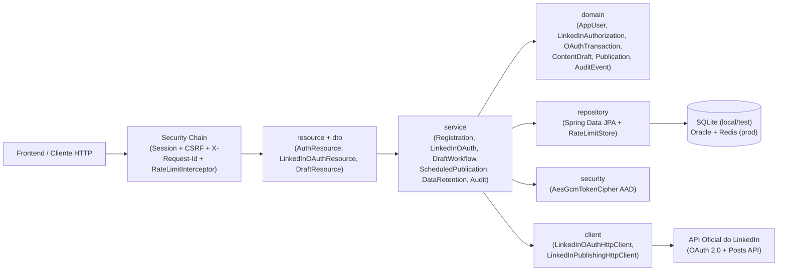
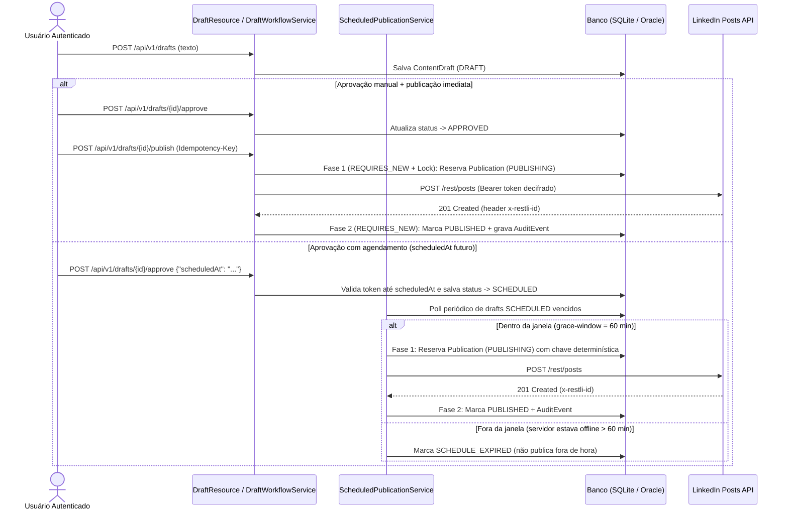

# linkedin-integration-backend

[](https://github.com/pedrohcnascimento/linkedin-integration-backend/actions/workflows/security-ci.yml)


Backend próprio, em Java 21 / Spring Boot 4, para integração **autorizada** com o LinkedIn via API oficial (**OpenID Connect** + produto **Share on LinkedIn** / **Posts API**).

> ⚠️ **Compromisso ético e de escopo:** este projeto **não** faz scraping, automação de navegador, uso de cookies de sessão ou qualquer ação fora dos endpoints oficiais documentados pelo LinkedIn. Veja [`docs/planejamento-tecnico.md`](docs/planejamento-tecnico.md) e [`docs/linkedin-capability-matrix.md`](docs/linkedin-capability-matrix.md).

---

## Status do projeto (v1 concluída)

✅ **Passo 16 — Revisão de portfólio e CI/CD concluído** ([`docs/progress/STEP-16.md`](docs/progress/STEP-16.md)), encerrando o ciclo v1 do roteiro operacional (Passos 1 a 16, com o **Passo 11 — oportunidades/vagas** formalmente adiado para ciclo posterior em [`docs/progress/STEP-11.md`](docs/progress/STEP-11.md)).

Destaques entregues e verificados por suíte automatizada:
- **Identidade local e segurança de sessão:** cadastro/login com BCrypt, rotação de sessão contra *session fixation*, CSRF obrigatório em escritas, timeouts de inatividade (`30m`) e absoluto (`8h`), e exclusão de conta/dados LGPD (`DELETE /api/v1/users/me`).
- **OAuth 2.0 + OpenID Connect com o LinkedIn:** `state` criptográfico de uso único persistido por hash SHA-256 e vinculado à sessão autenticada, tokens cifrados em repouso com **AES-256-GCM + AAD por usuário + rotação de chaves (`keyId`)**.
- **Fluxo completo de rascunhos, agendamento e publicação idempotente:** criação, listagem paginada, edição em `DRAFT`, aprovação manual ou agendada (`scheduledAt`), reagendamento/cancelamento, worker `@Scheduled` com janela de tolerância (`PT60M`), publicação na **Posts API** (`POST /rest/posts`) com reserva transacional em duas fases, lock pessimista e bloqueio `OUTCOME_UNKNOWN` contra duplicatas ([`docs/reconciliacao-manual-publicacoes.md`](docs/reconciliacao-manual-publicacoes.md)).
- **Observabilidade, Rate Limiting e CI/CD:** correlação `X-Request-Id` no MDC, trilha sanitizada `audit_event`, rate limiting fail-closed (memória em `local`/`test`; Lua atômico em Redis com chaves HMAC-SHA256 em `prod`), Docker multi-stage sem root e pipeline GitHub Actions com Testcontainers (Oracle Free + Redis), Docker smoke test, Gitleaks, CodeQL e OWASP Dependency-Check.

Para o estado funcional detalhado e precedência documental, consulte [`docs/status-atual.md`](docs/status-atual.md).

---

## Stack técnica

| Item | Escolha |
|---|---|
| Linguagem | Java 21 (LTS) |
| Build | Maven |
| Framework | Spring Boot **4.1.2** (`webmvc`, `security`, `validation`, `data-jpa`, `flyway`, `data-redis`, `actuator`) |
| Persistência | **SQLite** (`local`/`test`) e **Oracle** (`prod`, validado via Testcontainers em `ProdProfileOracleRedisIntegrationTest`), com Flyway `V1`–`V3` e Hibernate `ddl-auto=validate` |
| Rate Limiting | Em memória (`local`/`test`) e **Redis** compartilhado com scripts Lua atômicos (`prod`) |
| Integração LinkedIn | OAuth 2.0 + OpenID Connect (`/v2/userinfo`) e **Posts API** (`POST /rest/posts`, `Linkedin-Version` configurável) |
| Documentação de API | springdoc-openapi 3.2 (`/swagger-ui.html` e `/api-docs` ativos apenas em `local`/`test`; desativados em `prod`) |
| Empacotamento & CI | Docker multi-stage não-root + GitHub Actions (JUnit/Testcontainers, Docker smoke, Gitleaks, CodeQL, OWASP Dependency-Check) |

---

## Arquitetura e fluxo de publicação

O projeto segue uma arquitetura em camadas orientada a **Domain-Driven Design (DDD)**, mantendo os contratos externos do LinkedIn estritamente encapsulados em `client`, os payloads HTTP em `dto`, as regras e invariantes de estado em `domain` e a orquestração transacional em `service`.



### Fluxo de aprovação, agendamento e publicação idempotente



### Estrutura de pacotes

```text
com.example.linkedinagent
├── LinkedinAgentApplication.java   # Ponto de entrada Spring Boot, @EnableScheduling e guia OpenAPI
├── client/                         # Clientes HTTP isolados para a API oficial do LinkedIn (OAuth 2.0 + Posts API)
├── config/                         # Segurança, CORS, rate limit, OpenAPI, clientes HTTP e Clock injetável
├── domain/                         # Entidades e objetos de valor ricos com invariantes e transições de estado
├── dto/                            # Contratos REST de entrada/saída (*Dtos + ApiError), isolados do domínio
├── exception/                      # Exceções de domínio/integração e GlobalExceptionHandler (@RestControllerAdvice)
├── repository/                     # Repositórios Spring Data JPA, conversor Instant ISO-8601 e RateLimitStore
├── resource/                       # Endpoints REST (/api/v1/**): AuthResource, LinkedInOAuthResource, DraftResource
├── security/                       # Principal autenticado, cifragem AES-256-GCM, correlação e RateLimitInterceptor
└── service/                        # Orquestração transacional, agendamento, retenção LGPD e auditoria sanitizada
```

---

## Endpoints disponíveis

Todas as rotas de aplicação usam o prefixo `/api/v1`. Rotas protegidas exigem sessão local; requisições que alteram estado exigem também o header CSRF (`X-XSRF-TOKEN`).

| Método e caminho | Acesso | Função |
|---|---|---|
| `GET /api/v1/auth/csrf` | Público | Obtém o token CSRF e o nome do header (`X-XSRF-TOKEN`) |
| `POST /api/v1/auth/register` | Público | Cria uma conta local (`201`) |
| `POST /api/v1/auth/login` | Público | Autentica e inicia sessão com rotação de `JSESSIONID` |
| `POST /api/v1/auth/logout` | Sessão + CSRF | Encerra a sessão (`204`) |
| `GET /api/v1/users/me` | Sessão | Consulta os dados sanitizados da conta autenticada |
| `DELETE /api/v1/users/me` | Sessão + CSRF + senha | Exclui conta local, tokens, drafts/publicações e anonimiza auditoria (`204`) |
| `GET /api/v1/linkedin/oauth/start` | Sessão | Inicia o fluxo OAuth 2.0 e redireciona (`302`) ao LinkedIn |
| `GET /api/v1/linkedin/oauth/callback` | Sessão + `state` único | Conclui o OAuth e retorna estado sanitizado da conexão |
| `GET /api/v1/linkedin/connection` | Sessão | Consulta o estado sanitizado da conexão LinkedIn |
| `DELETE /api/v1/linkedin/connection` | Sessão + CSRF | Remove a autorização LinkedIn armazenada localmente (`204`) |
| `POST /api/v1/drafts` | Sessão + CSRF | Cria um rascunho textual (`DRAFT`) |
| `GET /api/v1/drafts?page=0&size=20` | Sessão | Lista rascunhos do usuário autenticado (`size` 1..50, `page` 0..100) |
| `PATCH /api/v1/drafts/{id}` | Sessão + CSRF | Edita texto/título enquanto o rascunho estiver em `DRAFT` |
| `POST /api/v1/drafts/{id}/approve` | Sessão + CSRF | Aprova o rascunho (`APPROVED` ou `SCHEDULED` se `scheduledAt` for enviado) |
| `PUT /api/v1/drafts/{id}/schedule` | Sessão + CSRF | Agenda ou reagenda publicação automática de rascunho aprovado |
| `DELETE /api/v1/drafts/{id}/schedule` | Sessão + CSRF | Cancela o agendamento e retorna o rascunho para `APPROVED` |
| `POST /api/v1/drafts/{id}/publish` | Sessão + CSRF | Publica rascunho aprovado; exige header `Idempotency-Key` (`201`) |
| `GET /api/v1/publications?page=0&size=20` | Sessão | Histórico paginado de publicações do usuário autenticado |

`GET /actuator/health` está disponível para health check sem expor detalhes internos. `/swagger-ui.html` e `/api-docs` ficam habilitados somente nos perfis `local` e `test`.

### Exemplo rápido via `curl` (perfil `local`)

```bash
# 1. Obter cookie e token CSRF
CSRF=$(curl -s -c cookies.txt http://localhost:8080/api/v1/auth/csrf | sed -n 's/.*"token":"\([^"]*\)".*/\1/p')

# 2. Criar conta local e autenticar (o login renova a sessão e o cookie XSRF-TOKEN)
curl -s -b cookies.txt -c cookies.txt -X POST http://localhost:8080/api/v1/auth/register \
  -H "Content-Type: application/json" -H "X-XSRF-TOKEN: $CSRF" \
  -d '{"email":"dev@example.com","displayName":"Dev Local","password":"strong-local-password"}'

CSRF=$(awk '$6=="XSRF-TOKEN"{print $7}' cookies.txt)
curl -s -b cookies.txt -c cookies.txt -X POST http://localhost:8080/api/v1/auth/login \
  -H "Content-Type: application/json" -H "X-XSRF-TOKEN: $CSRF" \
  -d '{"email":"dev@example.com","password":"strong-local-password"}'

# 3. Criar um draft textual e aprová-lo agendando publicação automática em UTC
CSRF=$(awk '$6=="XSRF-TOKEN"{print $7}' cookies.txt)
DRAFT_ID=$(curl -s -b cookies.txt -X POST http://localhost:8080/api/v1/drafts \
  -H "Content-Type: application/json" -H "X-XSRF-TOKEN: $CSRF" \
  -d '{"text":"Publicação via API oficial do LinkedIn.","mediaCategory":"NONE","title":"Post v1"}' \
  | sed -n 's/.*"id":"\([^"]*\)".*/\1/p')

# (Conecte antes a conta LinkedIn pelo navegador após iniciar GET /api/v1/linkedin/oauth/start)
curl -s -b cookies.txt -X POST "http://localhost:8080/api/v1/drafts/$DRAFT_ID/approve" \
  -H "Content-Type: application/json" -H "X-XSRF-TOKEN: $CSRF" \
  -d '{"scheduledAt":"2026-12-01T14:00:00Z"}'
```

---

## Como rodar localmente

> **Atenção ao perfil padrão (`prod` fail-safe):** em `application.yml`, a propriedade é `spring.profiles.active: ${SPRING_PROFILES_ACTIVE:prod}`. Sem `SPRING_PROFILES_ACTIVE=local` no `.env` ou no ambiente, a aplicação inicia em `prod` (exigindo Oracle, Redis e chaves de alta entropia, além de desativar o Swagger).

```bash
# 1. Copie o template de variáveis e habilite SPRING_PROFILES_ACTIVE=local no .env
cp .env.example .env

# 2. Executar suíte completa de testes
mvn clean test

# 3. Subir localmente em http://localhost:8080 (Swagger em /swagger-ui.html)
SPRING_PROFILES_ACTIVE=local mvn spring-boot:run
```

No **IntelliJ IDEA**: abra `pom.xml` como projeto Maven, garanta `SPRING_PROFILES_ACTIVE=local` no `.env` e execute `LinkedinAgentApplication`.

### Como rodar com Docker

```bash
# Sobe o container não-root no perfil local com volume persistente para SQLite (/app/data)
docker compose up --build

# Opcional: inclui um container Redis local restrito a 127.0.0.1:6379
docker compose --profile redis-local up --build
```

### Configuração de produção (`Oracle` + `Redis`)

Configure no ambiente de execução (nunca no Git):

```text
SPRING_PROFILES_ACTIVE=prod
DATABASE_URL=jdbc:oracle:thin:@<host>:1521:<service-name>
DATABASE_USERNAME=<usuario>
DATABASE_PASSWORD=<senha>
LINKEDIN_CLIENT_ID=<client id>
LINKEDIN_CLIENT_SECRET=<client secret>
LINKEDIN_REDIRECT_URI=https://<dominio>/api/v1/linkedin/oauth/callback
TOKEN_ENCRYPTION_KEY=<Base64 de 32 bytes aleatórios>
RATE_LIMIT_HMAC_KEY=<Base64 de >= 32 bytes aleatórios exclusivo de prod>
RATE_LIMIT_REDIS_URL=rediss://:<senha>@<redis-host>:6379
TRUSTED_PROXY_IPS=<IPs ou CIDRs do load balancer/reverse proxy>
APP_BASE_URL=https://<dominio>
CORS_ALLOWED_ORIGINS=https://<frontend>
```

---

## CI/CD e Verificação Contínua

O workflow [`.github/workflows/security-ci.yml`](.github/workflows/security-ci.yml) executa automaticamente em `push` e `pull_request` (`main` e `develop`) e semanalmente por agendamento:

1. **`test-and-dependency-check`:** compila em JDK 21 (Temurin) e roda `mvn -B clean verify` — incluindo a suíte completa de domínio, concorrência multi-thread, migrações SQLite `V1 -> V3` e `ProdProfileOracleRedisIntegrationTest` contra contêineres reais **Oracle Free 23** e **Redis 7.4** via Testcontainers — seguido do **OWASP Dependency-Check** (`failBuildOnCVSS=7`, requer o secret `NVD_API_KEY` configurado nas configurações do repositório GitHub).
2. **`docker-smoke`:** constrói a imagem multi-stage de produção, audita `/app` para garantir ausência de `.env`, chaves ou bancos `.db`/`.sqlite`, inicia o container e valida `/actuator/health` e `/api-docs`.
3. **`gitleaks`:** varre todo o histórico Git contra exposição acidental de segredos.
4. **`codeql`:** análise estática SAST (`security-extended`) para Java.

Atualizações semanais de dependências Maven e GitHub Actions são gerenciadas pelo [Dependabot](.github/dependabot.yml).

---

## Limitações conhecidas e escopo deliberado

- **Apenas publicações textuais de membro** na v1; upload de mídia/artigos e vagas/oportunidades ([`STEP-11.md`](docs/progress/STEP-11.md)) permanecem para ciclos futuros.
- **Agendamento local (`ScheduledPublicationService`):** depende da instância estar em execução; se o servidor estiver desligado no horário agendado e reiniciar em até `60 min` (`SCHEDULED_PUBLISH_GRACE_WINDOW`), publica automaticamente; após a janela, marca `SCHEDULE_EXPIRED` para evitar postagens em horário inadequado.
- **Reconciliação manual contra duplicatas:** falhas de rede/5xx pós-envio marcam a tentativa como `OUTCOME_UNKNOWN` e bloqueiam novas publicações do mesmo draft até conferência segundo [`docs/reconciliacao-manual-publicacoes.md`](docs/reconciliacao-manual-publicacoes.md).
- **Fora do escopo permanente:** scraping, cookies de sessão do LinkedIn, convites/mensagens automatizadas e Easy Apply automatizado.

---

## Documentação complementar

- Estado vigente e decisões: [`docs/status-atual.md`](docs/status-atual.md)
- Matriz oficial da API do LinkedIn: [`docs/linkedin-capability-matrix.md`](docs/linkedin-capability-matrix.md)
- Arquitetura e roteiro técnico: [`docs/planejamento-tecnico.md`](docs/planejamento-tecnico.md)
- Auditoria de segurança e LGPD: [`docs/PLANO_AUDITORIA_SEGURANCA.md`](docs/PLANO_AUDITORIA_SEGURANCA.md) e [`SECURITY.md`](SECURITY.md)
- Runbook de reconciliação manual: [`docs/reconciliacao-manual-publicacoes.md`](docs/reconciliacao-manual-publicacoes.md)
- Histórico de etapas (`STEP-01` a `STEP-16`): [`docs/progress/`](docs/progress/)
- Guia de contribuição: [`CONTRIBUTING.md`](CONTRIBUTING.md)

## Licença

Distribuído sob a licença MIT — veja [`LICENSE`](LICENSE).
